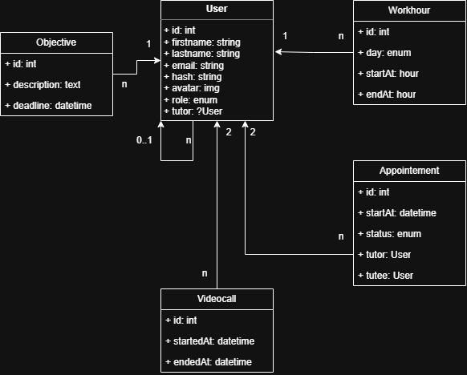

# Site web de tutorat

## Contexte 

### Contexte 
L'association **avenir** aide des adolescents et des jeunes adultes ayant des difficultés durant leurs études.

L'association met en relation les apprenants (tutorés) avec des mentors (tutors) bénévoles.

Aujourd'hui, le site n'a pas de fonctionnalité pour gérer la mise en relation des tuteurs et tutorés. Ceci doivent donc passer par des appels téléphoniques qui compliquent la gestion de l'association.

L'association avenir souhaite donc un nouveau site pour simplifier la mise en relation tuteurs/tutorés et le suivi des étudiants.

### Objectifs et utilisateurs du site

Réduire la charge causée par les appels téléphoniques.
Permettre aux tuteurs de suivres leurs étudiants et modifier leurs informations.
Permettre aux tutorés de suivre leurs objectifs et planifier des rendez-vous avec leur mentor.
Le site doit être simple d'utilisation. Les tuteurs et tutorés doivent passer au maximum par lui.

Les tuteurs sont des personnes de plus de 30 ans et parfois de plus de 60 ans. Ils ne sont pas tous à l'aise avec les outils informatiques.
Ils doivent pouvoir consuleter la fiche de leurs étudiants, modifier les informations, créer des objectifs, planifier des rendez-vous et participer à des visio-conférences.

Les tutorés sont des adolescents ou des jeunes adultes en difficulté scolaire avec parfois des situations familliales ou professionnelles compliquées. Ils n'ont pas de problèmes avec les outils informatiques.
Ils doivent pouvoir modifier leurs informations, consulter et suivre leurs objectifs, planifier des rendez-vous avec leur tuteur et participer à des visioconférences.

Les administrateurs sont les membres de l'association en charge de sa gestion.
Ils doivent pouvoir associer les tuteurs aux tutorés.

### Contraintes

Le livrable doit être un site consultable en ligne.

La finalisation du projet est prévue avant la rentrée de septembre (Dans 2 mois)

S'agissant d'un projet pour une association, le budget est limité.

Les données doivent être stockées en base de données.

Pas d'autres contraintes techniques.

## Spécifications fonctionnelles

### Fonctionnalités du site

Comptes utilisateurs pour les tuteurs et tutorés. Les tuteurs et tutorés doivent pouvoir modifier leurs informations

Les tutorés doivent pouvoir s'inscrire sur le site

Les tutorés doivent pouvoir suivre les objectifs fixés avec leur tuteur.
Les tuteurs doivent pouvoir fixer des objectifs aux tutorés

Les tutorés doivent pouvoir demander un rendez-vous auprès de leur tuteur.
Les tuteurs doivent pouvoir valider ou refuser un rendez-vous.
Les tuteurs et tutorés doivent pouvoir annuler leurs rendez-vous.

Les tuteurs et les tutorés doivent pouvoir participer à des visioconférences.

Les administrateurs peuvent associer un tuteur à un étudiant (tutoré).

### Product backlog 

https://app.notion.com/p/9d1a742fb04c830482cf01196c08ab32?v=a63a742fb04c8232ba5408dc44fbdba6

## Aperçu de l’interface utilisateur
*Les images et la description de l’interface réalisée par l’UX Designer et de la façon dont les fonctionnalités marcheront.*

## Solution technique

### Solution technique retenue 

L'utilisation du langage PhP et du framework Symfony a été retenue pour la conception du back-end. Le PhP est le principal langage du web, ce qui assure de trouver des développeurs pour maintenir le projet. C'est une technologie robuste et éprouvée.
Le framework partage ces qualités (Popularité, robustesse, etc.)

Le backend servira des pages web en html+css+js servira aux utilisateurs.

Pour sauvegarder les données, une base SQL sera utilisée. Grâce au bundle DoctrineORM, l'implémentation de la base (MariaDB, MySql, PostegreSql, voir Sqlite) peut-être ignorée (tant qu'aucune fonctionnalité unique à une base est utilisée), ce qui laisse plus de latitude pour le déploiement ou le choix de l'hébergeur.

### Diagrammes UML

### Modèle physique de données 

User(id: int NOT NULL [PK], firstname: string NOT NULL, lastname: string NOT NULL, email: string NOT NULL, password_hash: string NOT NULL, avatar_uri: string, tutor_id: int [FK reference User] role: enum NOT NULL)
Workhour (id: int NOT NULL [PK], tutor_id: int NOT NULL [FK reference User], day: enum NOT NULL, start_at: hour NOT NULL, end_at: hour NOT NULL)
Objective(id: int NOT NULL [PK], tutee_id: int NOT NULL [FK reference User], description: text NOT NULL, deadline: datetime)
Appointement(id: int NOT NULL [PK], tutee_id: int NOT NULL [FK reference User], tutor_id: int NOT NULL [FK reference User], start_at: datetime NOT NULL, status: enum NOT NULL)
Videocall(id: int NOT NULL [PK], tutee_id: int NOT NULL [FK reference User], tutor_id: int NOT NULL [FK reference User], started_at: datetime NOT NULL, ended_at: datetime NOT NULL)